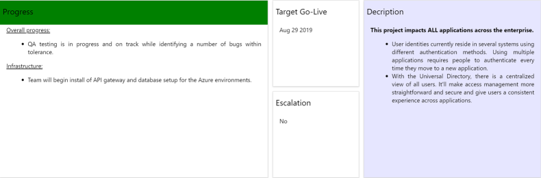
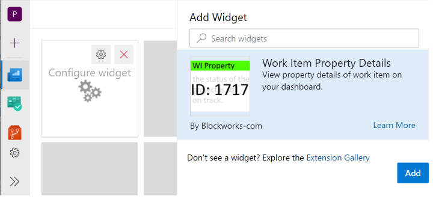
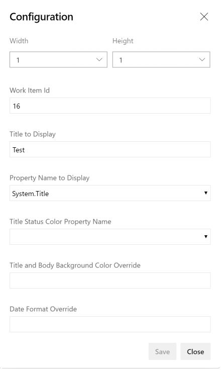
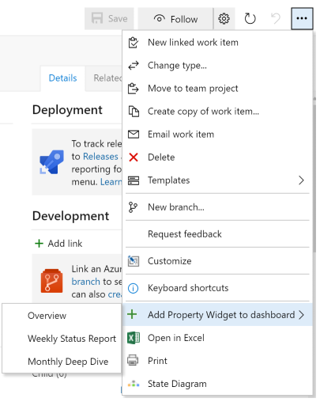

This is the new home of the Work Item Property Widget, formerly maintained at https://github.com/blockworks-com/Work-Item-Property-Widget. The extension ID and publisher (`blockworks-com`) are unchanged, so existing installs continue to update.

Based on https://github.com/ALM-Rangers/Work-Item-Details-Widget-Extension, with the ability to show a specific property.

Requires using Typescript 2.3.4

## Work Item Property Widget ##

The **Work Item Property Widget** displays a card showing the property selected on your dashboards. You select the work item and which property to display.

There are times when you have a parent or central work item that contains information that you want displayed on multiple dashboards. Instead of adding static content to each dashboard, this widget allows you to display information from the work item and then maintain the information in one location. 

## Use Cases

### Project Overview / Product Vision
You have a work item that contains an overview of the project. This might be a product vision that is shared across multiple teams and/or multiple projects. Display the project overview or product vision on many dashboards, while still only maintaining the content in the single work item. 

### Project Status
You have a Project work item that contains current status for a status report. Instead of maintaining the status separately, maintain it in the Project work item and display the status on the dashboard with other key information, such as burndown, so it's available for everyone on the team to view.

### Fill Title with Status Color
Your widget displays the progress for the project and you also have a progress-color property. Instead of have a separate widget displaying the progress-color, show it with the progress. After selecting the work item id and propery field then also select progress-color property for the Title Status Color. The background color of the Title is set to the specified property. Only the background of the title is set and the remainder of the widget is unaffected. 

### (New) Target Date
In the latest version of this widget, you can now specify the date format to display a date field. This is typically used when you want to display your Target Date or Go-Live Date on the dashboard. It uses the standard javascript formats, such as 'MMM DD YYYY'. The date format option only applies if the selected property is a date.

## Quick steps to get started

### Method 1

- Edit your dashboard
- Select the 'Work Item Property' widget
- Click Add to add the widget to your dashboard
- Click Configure on the widget

- Enter a Work Item Id and tab out of the text box.
- Enter a Title to display (at the top of the widget) and tab out of the text box.
- Select a Property Name and tab out of the dropdown.
- (Optional) Select a Title Status Color Property Name (sets the title bar color) and tab out of the dropdown. For example, this could be the status color for the project.
- (Optional) Enter a Title and Body Background Color Override to set the background color for the whole widget and the title bar, and tab out of the text box.
- (Optional) Enter a Date Format to format the widget context if it's a date and tab out of the text box. For example, use MMM DD YYYY to format the Target Go Live property.
- Click on Save

### Method 2

- Select the context menu "..." on any work item list, work item dialog, or board
- Select the item 'Add Property Widget to dashboard'
- Select the desired dashboard

### Notes

- You can select multiple work items in a list
- On the dashboard, click on the widget to open the work item in a modal form 

## Settings reference

To change these settings, click **Configure** on the widget. Only **Work Item Id** and **Property Name to Display** are needed to show the widget. The other settings are optional.

| Setting | What it does | Example |
|---|---|---|
| Work Item Id | The work item the widget shows. Open the work item and look at the address bar. The number at the end is the Work Item Id. | `4521` |
| Title to Display | The heading shown at the top of the widget. | `Project Overview` |
| Property Name to Display | The field on the work item whose content the widget shows. | `Description` |
| Title Status Color Property Name | A field on the work item that holds a color. The widget uses that color for the title bar. See Setting up a status color field below. | `Status Color` |
| Title and Body Background Color Override | A fixed color for the whole widget and the title bar. When you set it, it replaces the color from the status field. See Supported colors below. | `#FFC000` or `gold` |
| Date Format Override | Shows a date field in the format you choose. It's ignored if the property isn't a date. Use the [Moment.js format codes](https://momentjs.com/docs/#/displaying/format/). | `MMM DD YYYY` |
| Enable Telemetry | Sends anonymous usage counts so the widget can be improved. On by default. | On |
| Enable Debugging | For support only. Writes detailed messages to the browser console. | Off |

### Setting up a status color field

Use this when the title bar should change color based on a value on the work item, such as a Red, Amber, or Green status.

1. Choose a field on the work item to hold the status. For a fixed list of colors, use a **Picklist** field with the values you want, such as `Red`, `Amber`, and `Green`. If the field doesn't exist yet, ask your Azure DevOps administrator to add it.
2. Set the field on the work item, for example to `Amber`.
3. In the widget's **Configure** panel, choose that field in **Title Status Color Property Name**.

The title bar changes to match the field's value. If the field is empty, or its value isn't a color the widget recognizes, the title bar keeps its default color. Check the spelling of the value against the supported colors below.

Tip: `Green` is a dark green in the widget. For a brighter green, use a hex value such as `#00B050` as the picklist value.

## Supported colors

The **Title and Body Background Color Override** box and the **Title Status Color Property Name** field both take a standard web color. Use one of these forms:

- A color name, such as `red`, `orange`, `gold`, `green`, `blue`, `purple`, or `gray`. Names aren't case-sensitive.
- A hex value, such as `#FFC000`.
- An RGB value, such as `rgb(255, 192, 0)`.

`Amber` is also supported in either place, in any capitalization, and shows as `#FFC000`. To show pure yellow instead, use `Yellow` (`#ffff00`). Pick whichever name your team uses in the status field.

The widget picks black or white text automatically, so the text stays readable on the color you choose.

## Troubleshooting

**"Work Item Id has not been configured."**
Click **Configure**, enter a Work Item Id, and click **Save**.

**"TF401232: Work item Id: ... does not exist, or you do not have permissions to read it."**
Check the Work Item Id. You also need permission to view that work item.

**The title bar doesn't change color.**
Check that the status field has a value, that the spelling matches a supported color, and that **Title and Body Background Color Override** is empty. The override replaces the status color.

**A date isn't formatted.**
The property must be a date field, and the format must use valid codes, such as `MMM DD YYYY`.

**Some formatting is missing.**
For security, the widget removes scripts and other unsupported content. It keeps bold, italic, underline, headings, bulleted and numbered lists, links, and pictures stored at a web address. Links open in a new tab.

**Line breaks don't match what you typed.**
This is a known limitation. Line breaks in plain-text fields may not show as entered.

**Still stuck?**
Turn on **Enable Debugging**, click **Save**, reload the dashboard, and open the browser console (press F12, then select the Console tab). Send the messages with the issue to your widget administrator. The messages can include your setting values, so remove them before you share them outside your team. Then turn **Enable Debugging** off.

## Privacy
Please note that personal and confidential information is only saved in your Azure DevOps account using the built-in Azure DevOps data storage service "Team Services ExtensionDataService". You find more information about that service at Microsoft Docs: Azure DevOps Data storage.

Usage telemetry is on by default and can be turned off for each widget with **Enable Telemetry** in its configuration. It records which features are used and how often, using one-way hashes of your Azure DevOps user and organization IDs. It never includes the values you enter or the content of your work items. See [privacy.md](privacy.md) for details and retention periods.

## Notices
Notices for certain third party software included in this solution are provided here: [Third Party Notice](ThirdPartyNotices.txt).

## Contribute
All contributions from the GitHub community are welcome.

- Submit bugs and help us verify fixes  
- Submit pull requests for bug fixes and features and discuss existing proposals   
- Fork the repository
- Create a feature branch: `git checkout -b new-feature`
- Commit your changes
- Push to the branch: `git push origin new-feature`
- Submit a Pull Request

Please refer to [Contribution guidelines](.github/CONTRIBUTING.md) and the [Code of Conduct](.github/COC.md) for more details.
